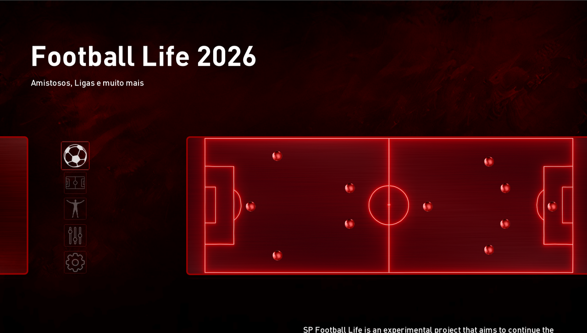
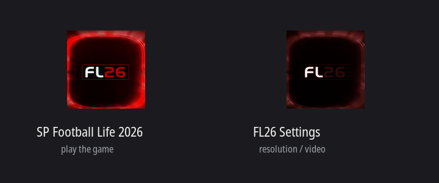

# SP Football Life 2026 (PES 2021) no Linux

**Jogue PES 2021 com o patch SP Football Life 2026 no Linux.** Um script só, sem sudo, controle funcionando, os dois updates aplicados.

**Leia em outros idiomas:** [English](README.md) · [Español](README.es.md)

Testado em sistemas baseados em Ubuntu e feito para funcionar também no **Bazzite, SteamOS e Steam Deck**, onde você não consegue instalar nada no sistema.

Eu consegui rodar o SP Football Life 2026 no Linux e ele joga muito bem, então anotei tudo que eu fiz.

Se você conhece esse jogo como PES 2021, eFootball PES 2021 Season Update, ou só Football Life, você está no lugar certo. O SP Football Life é o lançamento independente do SmokePatch feito em cima do PES 2021, e este guia cobre como rodar ele no Linux com Proton.

O PES 2021 não é mais vendido. O único motivo desse jogo continuar vivo é a equipe do SmokePatch, que segue lançando elencos, uniformes e estádios atualizados toda temporada. Todo o crédito pelo jogo e pelos patches é deles. Este repositório é só a parte do Linux.

Se você joga no Windows não precisa de nada disso. Baixe o jogo da página oficial e instale. Isso aqui é para quem está no Linux e quer jogar sem brigar com o Wine uma tarde inteira.

## Funciona mesmo?

Funciona. 1080p completo, controle funcionando, Sider carregando todos os mods, os dois updates aplicados e o jogo reportando a versão 2.2.0. Eu joguei uma partida inteira antes de escrever isso.



Essa é a máquina em que testei:

| | |
|---|---|
| Sistema | Zorin OS 18.1 (base Ubuntu 24.04) |
| Kernel | 7.0.0-28-generic |
| Ambiente | GNOME no X11 |
| CPU | AMD Ryzen 9 3900X, 24 threads |
| RAM | 62 GB |
| GPU | NVIDIA RTX 4070 Ti, driver 580.173.02 |
| Vulkan | 1.4.312 |
| Proton | GE-Proton11-3 |
| Controle | Xbox por USB |

Deve funcionar em qualquer distro com um driver Vulkan funcionando. Tudo é instalado dentro da sua pasta pessoal, então funciona também em sistemas imutáveis como Bazzite e SteamOS. Sem sudo em lugar nenhum.

## O que você precisa baixar

Pegue tudo na página oficial do SmokePatch. Não baixe de espelhos aleatórios:

**https://www.pessmokepatch.com/2025/10/spfl26.html**

Você precisa de três coisas:

1. **O jogo base** (`SPFL26_setup.exe` mais a pasta `Data` e o arquivo `.D01`)
2. **Update 2.0** (`SPFL26_200.exe`)
3. **Update 2.2** (`SPFL26_220.exe`)

Os updates importam. O download base é a versão 1.0 e sem eles você fica sem um monte de correções de elenco e de transferências. Instale o 2.0 primeiro, depois o 2.2. O arquivo do 2.2 diz "for v2" porque ele espera que o 2.0 já esteja lá.

### Dica: use o JDownloader

Os links estão espalhados por vários servidores com tempo de espera, e o jogo base tem uns 29 GB divididos em partes. O JDownloader cuida da fila, dos tempos de espera e das tentativas sozinho. Copie os links e deixe rodar durante a noite.

```bash
flatpak install flathub org.jdownloader.JDownloader
```

Mantenha todas as partes na mesma pasta. O instalador precisa da pasta `Data` do lado do `SPFL26_setup.exe`.

## Instalação rápida

Clone este repositório e aponte o script para a sua pasta de downloads:

```bash
git clone https://github.com/agentkyo/spfl26-pes2021-linux.git
cd spfl26-pes2021-linux
./install.sh --source ~/Downloads
```

Quer ver o que ele faria sem mexer em nada?

```bash
./install.sh --check --source ~/Downloads
```

O script confere seu sistema primeiro e diz o que está faltando antes de baixar um único byte. Ele olha espaço em disco, seu driver Vulkan, se a Steam está por perto, e se você já tem o GE-Proton ou uma instalação antiga parada ali.

```
==> Checking your system
  distro : Zorin OS 18.1
  kernel : 7.0.0-28-generic
  session: x11

  [ ok ] running as user, no root needed
  [ ok ] curl, tar, python3 and find are available
  [ ok ] 116 GB free in $HOME
  [ ok ] GPU: NVIDIA Corporation AD104 [GeForce RTX 4070 Ti]
  [ ok ] Vulkan driver: 580.173.02
  [ ok ] i386 multiarch enabled (needed by the 32 bit installers)
  [ ok ] Steam data found at /home/user/.steam/root
  [ ok ] GE-Proton11-3 already installed
  [ ok ] patch 2.0: /home/user/Downloads/SPFL26_200/SPFL26_200.exe
  [ ok ] patch 2.2: /home/user/Downloads/SPFL26_220/SPFL26_220.exe

  [ ok ] discovery passed
```

Depois ele baixa o GE-Proton11-3, monta o prefixo, roda o instalador do jogo, aplica os dois updates e coloca um atalho na sua área de trabalho.

Três janelas vão aparecer durante a instalação e você tem que clicar nelas. Essa parte não dá para automatizar, os instaladores do SmokePatch são só gráficos.

### A única coisa que você não pode errar

Todo instalador pergunta onde colocar os arquivos. Os três, o jogo base e os dois updates, precisam da **exata mesma pasta**. Qual pasta é escolha sua, desde que seja a mesma nas três vezes.

Dois caminhos funcionam:

```
C:\Games\SPFL26
C:\Program Files (x86)\SP Football Life 2026
```

O segundo é o que o instalador base sugere, então manter o padrão está de bom tamanho. O script confere os dois lugares depois e liga um ao outro, então o atalho acha o jogo de qualquer jeito.

O que quebra a instalação é misturar os dois. Os updates corrigem arquivos que já estão lá, então apontar eles para uma pasta vazia não te dá nada e nem erro nenhum. Se um instalador se oferecer para criar uma pasta que já deveria existir, diga **Não** e corrija o caminho, porque esse aviso quer dizer que você está no lugar errado.

Não use um caminho em `Z:\`. O `Z:` mapeia todo o seu sistema de arquivos do Linux e o Sider fica estranho com isso.

### Ordem de instalação

1. Jogo base
2. Update 2.0
3. Update 2.2

Confira o `dataSP/version.txt` dentro da pasta do jogo depois de cada um. Deve mostrar `1.0.0`, depois `2.0.0`, depois `2.2.0`.

Se alguma janela disser "não está respondendo", clique em Aguardar. O próprio instalador avisa isso na tela, ele para de responder ao gerenciador de janelas enquanto copia. Dê tempo. Se ele ficar no mesmo arquivo e na mesma porcentagem por vários minutos, aí sim travou de verdade. Feche e rode aquele instalador de novo.

## O atalho

O script cria um, **SP Football Life 2026**, na sua área de trabalho e no menu de aplicativos.

Antes ele criava um segundo para o `Settings.exe`, o programa que define resolução e modo de tela. Esse programa não roda no Proton, então o atalho saiu. Os detalhes estão abaixo.



### O Settings.exe não funciona, e o jogo vai bem sem ele

O `Settings.exe` é um app .NET que quer o .NET Framework 4.8. O Proton traz o Wine Mono no lugar, que é parecido mas não o suficiente aqui. Ele carrega e depois morre com um page fault dentro do `Settings_b.dll`:

```
mscoree:parse_supported_runtime sku="NETFramework,Version=v4.8" not implemented
wine: Unhandled page fault on read access to 00000004
err:mscoree:expect_no_runtimes Process exited with a Mono runtime loaded
```

Mesmo crash em todas as máquinas testadas, nos mesmos offsets, então não é coisa de driver nem de hardware. E não existe um segundo configurador no jogo, só o `Settings.exe` e a DLL dele.

O jogo roda num padrão razoável e partidas inteiras acontecem sem nunca abrir ele. É por isso que o atalho foi removido: um atalho que só quebra é pior que atalho nenhum.

O script ainda escreve o `~/Games/spfl26-settings.sh` se você quiser tentar. Instalar o .NET Framework 4.8 no prefixo com o winetricks talvez resolva. Isso não foi testado aqui, e é uma dependência pesada para um seletor de resolução, então fica como ideia e não como passo. Se você conseguir, um PR é bem-vindo.

## Controle

Essa é a parte que mais me custou tempo, então lê com atenção.

**Feche a Steam antes de jogar.** O Steam Input pega controle exclusivo do seu gamepad. Quando isso acontece, o jogo continua vendo o controle na lista de dispositivos mas nunca recebe um único botão. Parece que o controle está quebrado. Não está, a Steam só está comendo a entrada.

O atalho avisa se a Steam estiver aberta. Se o seu controle parar de funcionar do nada, é a primeira coisa para conferir.

Se você quiser manter a Steam aberta, vá em Configurações, Controle, e desligue o suporte a controle Xbox por lá.

## Se algo quebrar

Esses são os erros que eu peguei e o que resolveu.

**O script diz `FL_2026.exe not found` enquanto o instalador ainda está copiando**

O `SPFL26_setup.exe` é um bootstrapper. Ele descompacta o instalador de verdade, inicia ele, e sai na hora. Qualquer coisa que espere por esse primeiro processo acha que a instalação terminou depois de alguns segundos e vai procurar um jogo que ainda não copiou um único arquivo.

Espere pelo prefixo em vez do processo:

```bash
WINEPREFIX="$PREFIX/pfx" wineserver -w
```

Isso retorna quando tudo dentro do prefixo terminou, bootstrapper e instalador. O script faz isso agora, então se você vê esse erro está numa cópia antiga.

**O script escolhe a GPU errada num notebook**

Pegar o primeiro adaptador de vídeo do `lspci` te dá o chip integrado em qualquer notebook híbrido, porque é essa a ordem que o barramento reporta. Filtre por uma placa dedicada primeiro e caia no primeiro adaptador só quando existe uma placa só:

```bash
lspci | grep -iE 'vga|3d|display' | grep -iE 'nvidia|amd/ati|radeon' | head -1
```

**`Unable to create interface ISteamUser`**

Esse é o grande. O jogo traz o próprio emulador da API da Steam, e o Proton injeta o `lsteamclient` para fazer a ponte das chamadas da Steam para o cliente nativo do Linux. Essa ponte captura a chamada antes do emulador do jogo conseguir responder. A correção é mandar o Proton sair do caminho:

```
WINEDLLOVERRIDES="lsteamclient=d"
```

O atalho já faz isso. Se você rodar o jogo de outro jeito, precisa disso também.

**Tela preta, cooler girando, nada acontece**

Mesma causa raiz da anterior, só que mais silenciosa. No Wine puro não aparece erro nenhum, o jogo só fica numa janela preta queimando 500% de CPU para sempre. Se você ver isso, está faltando o override `lsteamclient=d`.

**`Failed to load System.Private.CoreLib.dll` / erro `0x8007046C`**

O `FL 2026 start.exe` é um app .NET de arquivo único e o Wine 8 não consegue mapear os assemblies embutidos nele. O erro `0x8007046C` é `ERROR_MAPPED_ALIGNMENT`. Use Wine 10 ou mais novo, ou GE-Proton11 como neste guia. Versões mais antigas do Proton vão falhar aqui.

**O jogo trava quando eu uso um desktop virtual**

Não use o desktop virtual do Wine para contornar problemas de tela cheia. Ele quebra o Vulkan (o `VK_KHR_surface` some) e o jogo trava em vez de só se comportar mal.

**Uma janela preta de console fica em loop depois de um update**

No fim dos updates roda um script chamado `OneDrive.bat`. No Windows ele move seu save entre a pasta Documentos normal e a do OneDrive. Aqui não existe OneDrive, então ele pergunta "arquivo ou diretório?" sem parar e nunca termina.

Só feche essa janela. O update já terminou e seu save está bem. Se fechar não resolver:

```bash
pkill -x cmd.exe
pkill -x xcopy.exe
```

**Um update trava na mesma porcentagem para sempre**

Confira se ele travou de verdade antes de matar. Olhe a contagem de arquivos e o tamanho da pasta, não a barra de progresso:

```bash
GAME=~/Games/spfl26/drive_c/Games/SPFL26
find "$GAME" -type f | wc -l && du -sh "$GAME"
```

Rode isso duas vezes, com trinta segundos de diferença. Se os dois números andarem, está funcionando e você só precisa esperar. Se nenhum andar por alguns minutos, travou. Feche e rode aquele update de novo.

Não confira com `find -newermt`. Os instaladores mantêm os timestamps originais dos arquivos que escrevem, então uma checagem por tempo não mostra nada mesmo enquanto ele copia. Essa me enganou por um tempo.

Também não aponte um update para uma pasta que é link simbólico. Eu tentei ligar o `C:\Program Files (x86)\SP Football Life 2026` à pasta real do jogo para não ter que digitar o caminho, e o update 2.0 travava em 38 por cento toda vez. Apontar para a pasta real terminou sem problema.

O script liga os dois caminhos para o atalho funcionar de qualquer jeito, o que quer dizer que um deles é um link simbólico na sua máquina também. É por isso que ele imprime a pasta real na tela antes de cada janela de update abrir. Digite o caminho que ele imprime, não o outro.

## Onde tudo fica

```
~/Games/
├── spfl26-proton/                 prefixo e dados de compatibilidade do Proton
├── spfl26-play.sh                 atalho do jogo
└── spfl26-settings.sh             atalho do settings, veja a nota acima
```

Nada é escrito fora da sua pasta pessoal. Para desinstalar, apague `~/Games/spfl26*` e o arquivo `.desktop`.

## Créditos

**[SmokePatch](https://www.pessmokepatch.com/)** fez o SP Football Life e cada update. Eles fazem isso de graça, temporada após temporada, para um jogo que a publicadora abandonou. Vai lá agradecer no site deles.

**Sider**, do juce, é o que carrega todos os mods dentro do jogo.

**[GloriousEggroll](https://github.com/GloriousEggroll/proton-ge-custom)** pelo GE-Proton.

Eu só descobri o lado Linux e escrevi. Paga um café para a equipe do SmokePatch, não para mim.

## Contribuindo

Conseguiu rodar em outra distro? Abre uma issue e conta suas especificações e o que você teve que mudar. Relatos de Bazzite e SteamOS são especialmente bem-vindos.
